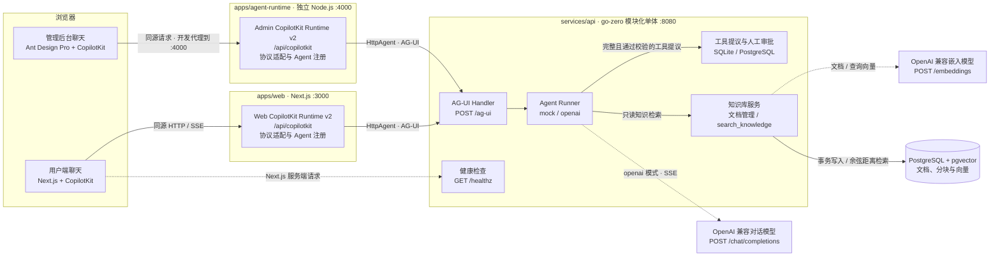
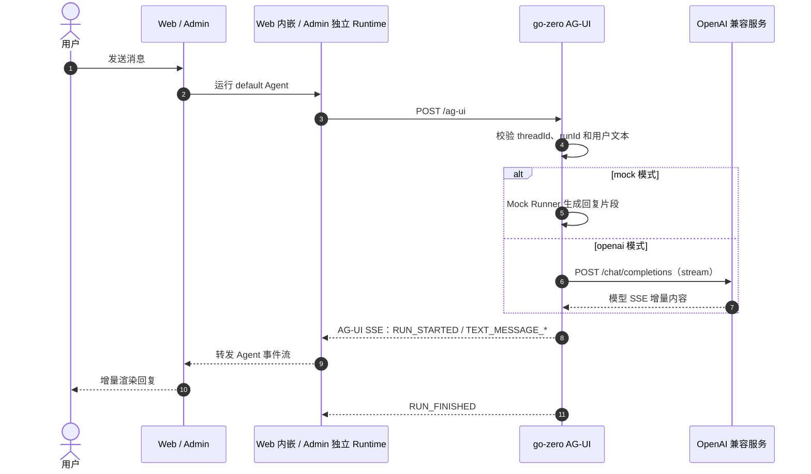
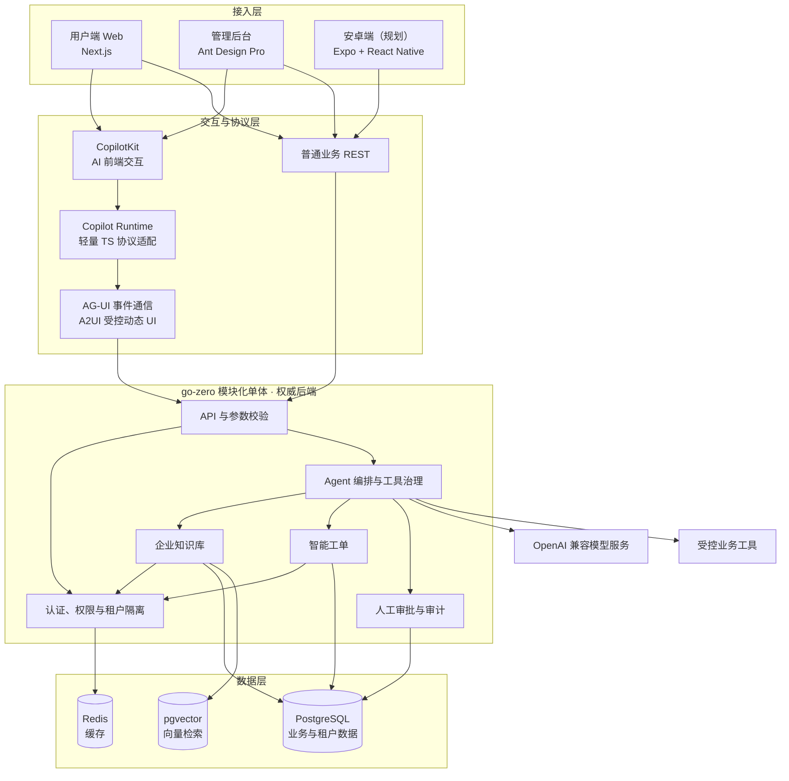

# NexusAI 架构

本文档区分**当前代码链路**与**目标架构**。实线表示当前请求链路，虚线表示可选模型调用或服务端辅助请求；规划能力不会写成已实现能力。

## 1. 当前系统架构

### 组件职责

| 组件 | 当前职责 | 明确不负责 |
| --- | --- | --- |
| `apps/web` | 用户端页面、聊天 UI、API 健康状态；承载 Web 自己的 CopilotKit Runtime | 企业业务规则、权限最终判定、Admin Runtime 托管 |
| `apps/admin` | 管理后台页面、AI 聊天、知识文档管理、工具审批与工单处理 UI；开发环境代理到独立 Runtime 和 go-zero | 生产反向代理、业务权限权威 |
| `apps/agent-runtime` | 独立运行的 Admin CopilotKit Runtime，默认监听 `127.0.0.1:4000` | 企业业务、模型调用、用户端页面托管 |
| CopilotKit Runtime | Agent 发现、`default` Agent 注册、前端协议适配、AG-UI 转发 | 企业业务、模型调用、租户隔离、审批、审计 |
| go-zero API | 请求校验、AG-UI SSE 响应、Runner 选择、工具白名单、知识文档管理、参数校验、审批决策和工单状态流转 | 真实认证、租户隔离与审计 |
| Agent Runner | Mock 文本流，或调用 OpenAI 兼容模型并转换文本与工具调用事件；只读工具完成后发起第二次模型请求 | 绕过服务端直接执行后台操作 |
| 知识库服务 | Unicode 分块、1536 维向量生成、文档与分块事务写入、`search_knowledge` 只读检索（含距离阈值过滤与回答引用校验）和文档删除级联 | 文件解析、知识权限与租户隔离、逐句事实校验 |
| 审批与工单存储 | `NewData` 统一拥有进程级 Ent Client；默认使用 SQLite 共享内存，配置 `NEXUS_POSTGRES_DSN` 后使用 PostgreSQL，通过事务处理审批和状态更新 | 生产授权、审计与多租户数据约束 |
| PostgreSQL / pgvector / Redis | PostgreSQL 承载业务数据和知识向量，pgvector 提供 HNSW 余弦距离检索；Docker Compose 提供本地基础设施 | Redis 业务缓存集成、SQLite 向量相似度检索 |

Web 与 Admin 使用彼此独立的 Runtime 进程，关闭 Web 不会中断 Admin 的 AI 聊天链路。两个 Runtime 都只允许转发 `authorization` 和 `x-tenant-id` 请求头，以减少浏览器请求头的无意泄露。请求头转发只是协议能力，不代表认证或租户隔离已经实现。

## 2. 流式聊天时序

正常文本运行包含 `RUN_STARTED`、`TEXT_MESSAGE_START`、若干 `TEXT_MESSAGE_CONTENT`、`TEXT_MESSAGE_END` 和 `RUN_FINISHED`。运行失败时，go-zero 在响应尚未开始时返回错误；流已经开始后则发送 `RUN_ERROR`。客户端断开连接会取消后续模型请求。

知识问答使用两段式模型调用：第一次请求由模型决定是否调用 `search_knowledge`，go-zero 生成查询向量并通过 pgvector 返回最相关分块，第二次请求携带工具结果生成最终答案。知识检索是只读工具，不进入人工审批；文档导入、列表、详情和删除使用普通 REST。完整流程见[知识库问答流程](./knowledge-qa-flow.md)。

OpenAI 兼容模型提议 `create_ticket` 时，go-zero 转发 `TOOL_CALL_START`、`TOOL_CALL_ARGS` 和 `TOOL_CALL_END` 事件，并只在完整模型流结束后校验参数、写入待审批记录。Admin `/approvals` 页面通过同源 `/api/nexus` 代理读取记录并提交人工决策；`POST /approvals/:id/approve` 批准后才在当前存储中创建工单，`POST /approvals/:id/reject` 拒绝则不执行，重复决策返回 409。Admin `/tickets` 页面通过 `GET /tickets` 读取工单，并通过 `PATCH /tickets/:id/status` 按 `open → in_progress → resolved` 顺序处理；go-zero 拒绝非法状态、跳级和回退，当前不提供删除或重新打开操作。默认存储为 SQLite 共享内存；配置 `NEXUS_POSTGRES_DSN` 后使用 PostgreSQL，并通过事务保证批准和状态更新的一致性，PostgreSQL 额外使用行锁避免并发重复决策。不完整流、未知工具和无效参数均不会生成审批记录。

## 3. 目标架构（规划）

目标仍是 **go-zero 模块化单体**，不是提前拆分微服务。知识库、工单和人工审批已有当前实现；下图重点表达身份权限、生产级审批审计、A2UI 和移动端等后续建设方向，不代表这些模块全部尚未开始。

## 4. 核心边界与约束

### 4.1 一个权威后端

- go-zero 是唯一企业业务与 Agent 后端。
- Copilot Runtime 只负责 CopilotKit 与 AG-UI 的协议适配，不重复实现企业业务。Web 使用 Next.js 内嵌 Runtime，Admin 使用 `apps/agent-runtime` 独立服务；两者都不是新的 Agent 后端。
- 第一阶段使用模块化单体，不引入 NestJS、Python Agent 服务、Kubernetes 或复杂微服务体系。

### 4.2 模型不是权限边界

- 模型只能提议工具调用。
- go-zero 必须重新执行身份认证、租户隔离、参数校验和权限判断。
- 高风险后台操作必须经过人工审批，并留下审计记录。
- 前端状态、工具参数和模型输出都不能作为授权依据。

### 4.3 协议按用途划分

| 协议 / 入口 | 用途 |
| --- | --- |
| REST | 普通企业业务、管理操作 |
| AG-UI | Agent 运行与事件流通信 |
| A2UI（规划） | 在受控 schema 内生成动态 UI |
| CopilotKit Runtime | 前端接入、Agent 发现与协议适配，不承载业务权威 |

### 4.4 契约生成与同步

- `services/api/api/nexus.api` 聚合 go-zero `.api` 文件，是后端 HTTP 契约的生成入口，也是唯一需要提交的契约来源。
- `pnpm generate:contracts` 使用固定版本 goctl 生成 `apps/admin/schema/openapi.json`，记录每个操作来源的 `.api` 文件，再通过 `@umijs/openapi` 在 `apps/admin/src/services/nexus/` 按契约生成 service：`health.api` 对应 `health.ts`、`ag-ui.api` 对应 `agUi.ts`、`approval.api` 对应 `approval.ts`、`ticket.api` 对应 `ticket.ts`；同一契约的多个函数聚合在同一文件中，类型和入口文件共享。
- OpenAPI JSON 和 TypeScript 客户端是 Git 忽略的本地生成产物，每次生成都会覆盖手工修改；克隆仓库或修改契约后必须先执行生成命令。
- 生成脚本只执行确定性的兼容转换：移除时间戳、提升内联请求与响应模型、补齐路径参数声明。业务字段和路径仍来自 `.api`，不在脚本中另写接口定义。
- CI 先生成契约产物，再执行 `pnpm check:contracts` 验证重复生成结果一致，随后运行 Admin 检查、测试和构建。
- AG-UI 的 SSE 事件仍由 Runtime 使用协议客户端处理；生成的普通请求函数不替代流式事件链路。

### 4.5 数据与密钥

- PostgreSQL 保存业务数据，pgvector 提供知识检索；Redis 规划用于缓存，但尚未接入业务链路。
- 模型密钥只注入 go-zero 运行环境，不下发到浏览器或写入仓库。
- 多租户数据访问必须由后端统一约束，不能仅依赖前端传入的租户标识。

## 5. 当前缺口

以下能力不能依据现有聊天和知识库页面推断为已完成：

- 真实后台认证、授权和租户隔离，包括知识文档与检索结果的租户级隔离。
- 生产级审批授权与审计。
- PDF、Word 等文件解析、异步导入、检索重排序、标准化答案引用列表和逐句事实一致性校验；当前知识入口接收纯文本，检索按余弦距离返回 Top N、按阈值过滤低相关分块，并已校验回答引用的来源是否在本次检索结果内。
- 默认 SQLite 共享内存模式下的审批、工单和知识文档会在重启后清空；PostgreSQL 持久化需要显式配置 DSN，真实向量检索也必须使用 PostgreSQL + pgvector。
- Redis 缓存与业务链路的实际集成。
- Admin 生产环境同源反向代理与完整部署拓扑。
