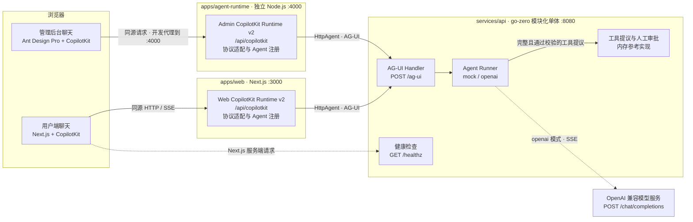
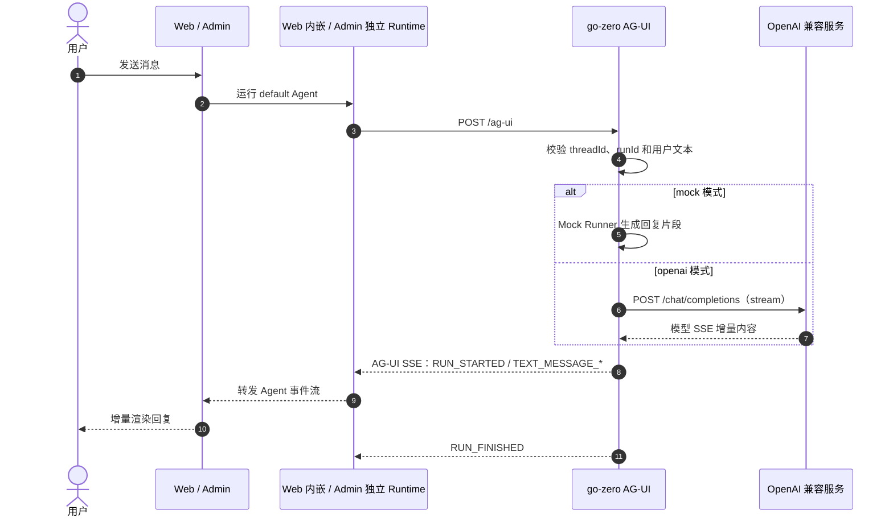
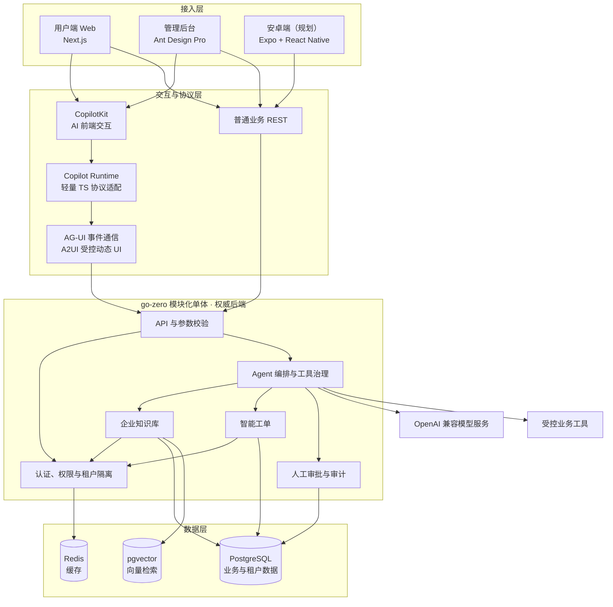

# NexusAI 架构

本文档区分**当前代码链路**与**目标架构**。实线表示当前请求链路，虚线表示可选模型调用或服务端辅助请求；规划能力不会写成已实现能力。

## 1. 当前系统架构

### 组件职责

| 组件 | 当前职责 | 明确不负责 |
| --- | --- | --- |
| `apps/web` | 用户端页面、聊天 UI、API 健康状态；承载 Web 自己的 CopilotKit Runtime | 企业业务规则、权限最终判定、Admin Runtime 托管 |
| `apps/admin` | 管理后台页面、AI 聊天与工具审批 UI；开发环境代理到独立 Runtime 和 go-zero | 生产反向代理、业务权限权威 |
| `apps/agent-runtime` | 独立运行的 Admin CopilotKit Runtime，默认监听 `127.0.0.1:4000` | 企业业务、模型调用、用户端页面托管 |
| CopilotKit Runtime | Agent 发现、`default` Agent 注册、前端协议适配、AG-UI 转发 | 企业业务、模型调用、租户隔离、审批、审计 |
| go-zero API | 请求校验、AG-UI SSE 响应、Runner 选择、工具白名单、参数校验和审批决策 | 真实认证、租户隔离、持久化审批与审计 |
| Agent Runner | Mock 文本流，或调用 OpenAI 兼容模型并转换文本与工具调用事件 | 绕过服务端直接执行后台操作 |
| 内存审批存储 | 保存待审批提议；批准后创建内存工单，拒绝则不执行 | 服务重启后的持久性、生产授权与审计 |
| PostgreSQL / pgvector / Redis | Docker Compose 已提供本地基础设施 | 当前聊天与审批链路尚未读写这些组件 |

Web 与 Admin 使用彼此独立的 Runtime 进程，关闭 Web 不会中断 Admin 的 AI 聊天链路。两个 Runtime 都只允许转发 `authorization` 和 `x-tenant-id` 请求头，以减少浏览器请求头的无意泄露。请求头转发只是协议能力，不代表认证或租户隔离已经实现。

## 2. 流式聊天时序

正常文本运行包含 `RUN_STARTED`、`TEXT_MESSAGE_START`、若干 `TEXT_MESSAGE_CONTENT`、`TEXT_MESSAGE_END` 和 `RUN_FINISHED`。运行失败时，go-zero 在响应尚未开始时返回错误；流已经开始后则发送 `RUN_ERROR`。客户端断开连接会取消后续模型请求。

OpenAI 兼容模型提议 `create_ticket` 时，go-zero 转发 `TOOL_CALL_START`、`TOOL_CALL_ARGS` 和 `TOOL_CALL_END` 事件，并只在完整模型流结束后校验参数、写入待审批记录。Admin `/approvals` 页面通过同源 `/api/nexus` 代理读取记录并提交人工决策；`POST /approvals/:id/approve` 批准后才创建内存工单，`POST /approvals/:id/reject` 拒绝则不执行，重复决策返回 409。不完整流、未知工具和无效参数均不会生成审批记录。

## 3. 目标架构（规划）

目标仍是 **go-zero 模块化单体**，不是提前拆分微服务。下图中的知识库、工单、身份权限、审批审计、A2UI 和移动端均为后续建设内容。

## 4. 核心边界与约束

### 4.1 一个权威后端

- go-zero 是唯一企业业务与 Agent 后端。
- Copilot Runtime 只负责 CopilotKit 与 AG-UI 的协议适配，不重复实现企业业务。Web 使用 Next.js 内嵌 Runtime，Admin 使用 `apps/agent-runtime` 独立服务；两者都不是新的 Agent 后端。
- 第一阶段使用模块化单体，不引入 NestJS、Python Agent 服务、Kubernetes 或复杂微服务体系。

### 4.2 模型不是权限边界

- 模型只能提议工具调用。
- go-zero 必须重新执行身份认证、租户隔离、参数校验和权限判断。
- 高风险后台操作必须经过人工审批，并留下审计记录。
- 前端状态、工具参数和模型输出都不能作为授权依据。

### 4.3 协议按用途划分

| 协议 / 入口 | 用途 |
| --- | --- |
| REST | 普通企业业务、管理操作 |
| AG-UI | Agent 运行与事件流通信 |
| A2UI（规划） | 在受控 schema 内生成动态 UI |
| CopilotKit Runtime | 前端接入、Agent 发现与协议适配，不承载业务权威 |

### 4.4 契约生成与同步

- `services/api/api/nexus.api` 聚合 go-zero `.api` 文件，是后端 HTTP 契约的生成入口，也是唯一需要提交的契约来源。
- `pnpm generate:contracts` 使用固定版本 goctl 生成 `apps/admin/schema/openapi.json`，记录每个操作来源的 `.api` 文件，再通过 `@umijs/openapi` 在 `apps/admin/src/services/nexus/` 按契约生成 service：`health.api` 对应 `health.ts`、`ag-ui.api` 对应 `agUi.ts`、`approval.api` 对应 `approval.ts`；同一契约的多个函数聚合在同一文件中，类型和入口文件共享。
- OpenAPI JSON 和 TypeScript 客户端是 Git 忽略的本地生成产物，每次生成都会覆盖手工修改；克隆仓库或修改契约后必须先执行生成命令。
- 生成脚本只执行确定性的兼容转换：移除时间戳、提升内联请求与响应模型、补齐路径参数声明。业务字段和路径仍来自 `.api`，不在脚本中另写接口定义。
- CI 先生成契约产物，再执行 `pnpm check:contracts` 验证重复生成结果一致，随后运行 Admin 检查、测试和构建。
- AG-UI 的 SSE 事件仍由 Runtime 使用协议客户端处理；生成的普通请求函数不替代流式事件链路。

### 4.5 数据与密钥

- PostgreSQL 保存业务数据，pgvector 提供知识检索，Redis 提供缓存。
- 模型密钥只注入 go-zero 运行环境，不下发到浏览器或写入仓库。
- 多租户数据访问必须由后端统一约束，不能仅依赖前端传入的租户标识。

## 5. 当前缺口

以下能力不能依据现有聊天页面推断为已完成：

- 真实后台认证、授权和租户隔离。
- 生产级审批授权与审计。
- 知识库 ingestion、检索和引用。
- 工单与审批记录的 PostgreSQL 持久化；当前内存记录会在重启后清空。
- PostgreSQL、pgvector、Redis 与业务链路的实际集成。
- Admin 生产环境同源反向代理与完整部署拓扑。
