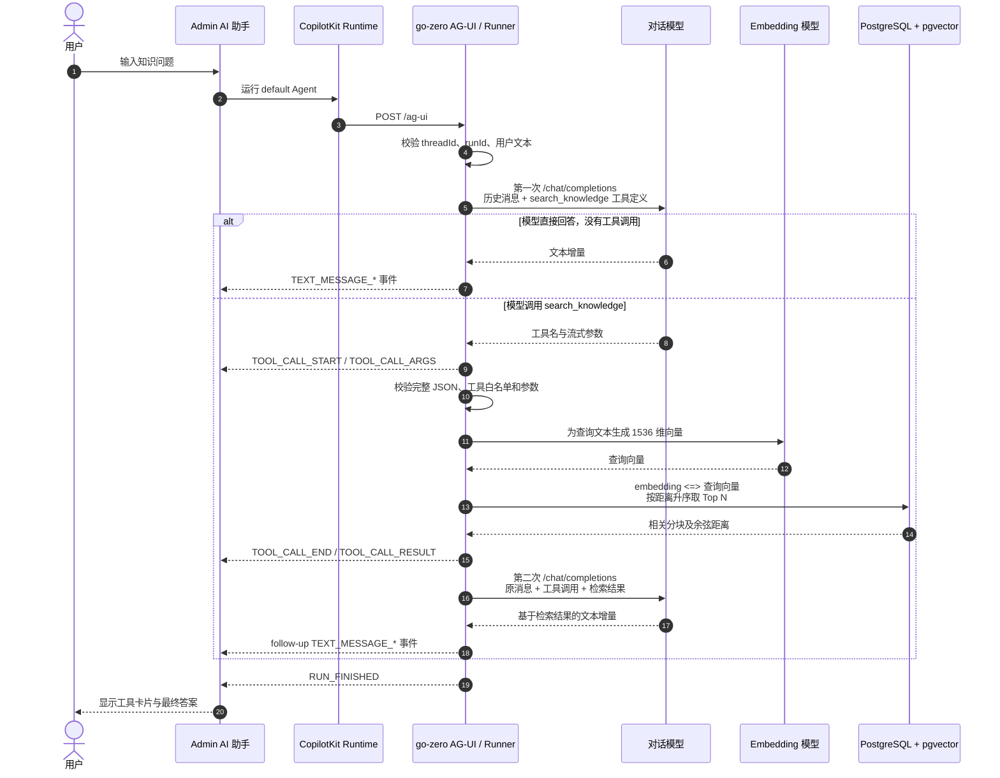

# NexusAI 知识库问答流程

本文档说明当前代码已经实现的知识文档导入、向量检索和 AI 问答链路。知识检索由 go-zero 后端统一完成，CopilotKit Runtime 只负责协议转发，不直接访问模型、数据库或知识库。

## 1. 总体流程

知识库问答分为两个阶段：

1. **知识入库**：文档分块，为每个分块生成向量，并将原文、分块和向量事务写入数据库。
2. **知识问答**：对话模型决定是否调用 `search_knowledge`，后端执行向量检索，再将检索结果交还对话模型生成最终答案。

```mermaid
flowchart LR
    subgraph Ingestion["知识入库"]
        AdminKnowledge["Admin /knowledge"] -->|"POST /knowledge/documents"| IngestAPI["go-zero 导入接口"]
        IngestAPI --> Split["Unicode 安全分块"]
        Split --> EmbedChunks["Embedding 模型<br/>生成分块向量"]
        EmbedChunks --> Tx["事务写入 documents / chunks"]
        Tx --> VectorDB[("PostgreSQL + pgvector")]
    end

    subgraph QA["知识问答"]
        User["用户"] --> Chat["Admin /ai-chat"]
        Chat --> Runtime["CopilotKit Runtime"]
        Runtime -->|"POST /ag-ui"| Runner["go-zero OpenAIRunner"]
        Runner -->|"第一次请求：消息 + 工具定义"| ChatModel["对话模型"]
        ChatModel -->|"search_knowledge 工具调用"| Search["go-zero 知识检索"]
        Search --> EmbedQuery["Embedding 模型<br/>生成查询向量"]
        EmbedQuery --> VectorSearch["pgvector 余弦距离检索"]
        VectorSearch --> Matches["最相关知识分块"]
        Matches -->|"工具结果"| FollowUp["第二次对话模型请求"]
        FollowUp -->|"AG-UI SSE"| Chat
        Chat --> Answer["流式显示最终答案"]
    end

    VectorDB --> VectorSearch
```



## 2. 知识文档入库

### 2.1 请求入口

在 Admin 的 `/knowledge` 页面提交标题和正文，前端通过同源 `/api/nexus` 代理调用：

```http
POST /knowledge/documents
Content-Type: application/json

{
  "title": "NexusAI 测试运维手册",
  "content": "文档正文……"
}
```

go-zero 校验以下输入：

- 标题去除首尾空白后必须为 1～200 个 Unicode 字符。
- 正文去除首尾空白后不能为空。
- 未配置嵌入模型时，导入接口返回 HTTP 503。
- 其他导入失败返回通用 HTTP 500，详细原因只记录在服务端日志中。

### 2.2 分块与向量生成

`knowledge.Service.IngestDocument` 执行以下步骤：

1. 按 Unicode 字符切分正文，不按 UTF-8 字节截断，避免破坏中文等多字节字符。
2. 默认每个分块最多 **800 字**，相邻分块重叠 **120 字**。
3. 将全部非空分块交给 OpenAI 兼容 Embedding 接口，每批最多 **64 个分块**。
4. 请求地址为 `{NEXUS_OPENAI_EMBEDDING_BASE_URL}/embeddings`。
5. 请求显式指定 **1536 维**，并校验响应数量、索引、重复索引和向量维度。
6. 任一分块向量缺失或维度不正确，整篇文档导入失败。

### 2.3 事务写入

文档与全部分块在同一个数据库事务中写入：

- `documents` 保存文档 ID、标题、完整原文和时间戳。
- `chunks` 保存分块 ID、文档 ID、顺序号、分块正文和向量。
- `(document_id, ordinal)` 唯一索引保证同一文档内分块顺序不重复。
- 任一分块写入失败，文档和此前写入的分块一起回滚。

生产检索使用 PostgreSQL + pgvector，向量字段为 `vector(1536)`，并通过以下 HNSW 索引加速余弦距离查询：

```sql
CREATE INDEX IF NOT EXISTS chunks_embedding_hnsw_idx
    ON chunks USING hnsw (embedding vector_cosine_ops);
```

SQLite 仅用于开发测试中的数据持久化和级联删除验证，**不实现向量相似度检索**。

## 3. 知识问答详细时序



## 4. 第一次模型请求：决定是否检索

go-zero 将用户消息和工具定义发送给 OpenAI 兼容对话接口：

```http
POST {NEXUS_OPENAI_BASE_URL}/chat/completions
```

当前 `search_knowledge` 工具定义包含：

| 参数 | 规则 | 含义 |
| --- | --- | --- |
| `query` | 必填，1～1000 个 Unicode 字符 | 自然语言问题或关键词 |
| `limit` | 可选，1～10，默认 5 | 返回的最相关分块数量 |

该工具是**只读工具**，通过 `Tool.Execute` 直接执行，不进入人工审批。`create_ticket` 等会改变业务状态的工具仍使用 `Tool.Propose`，必须人工批准后才执行。

如果嵌入模型未配置，知识服务和 `search_knowledge` 工具都不会注册。此时对话仍可能运行，但模型没有知识库检索能力，不能把这种情况下的回答视为知识库问答。

## 5. 后端执行知识检索

模型流式返回工具调用时，Runner 先累积完整参数，再执行以下校验与查询：

1. 工具必须已注册，参数必须是完整、合法的 JSON。
2. 查询文本不能为空，最长 1000 个 Unicode 字符。
3. 查询向量与文档分块使用同一嵌入配置和 1536 维约束。
4. 使用 pgvector 的 `<=>` 运算符计算余弦距离，按距离从小到大排序（距离越小越相似）。
5. 将召回候选数放大为请求 limit 的 `SearchRecallFactor`（当前为 4）倍、上限为存储层最大值 50，为重排序提供候选池。
6. 过滤掉余弦距离超过 `SearchDistanceThreshold`（当前为 0.5）的低相关分块。
7. 按「余弦距离 + 关键词覆盖率」的混合分数重排序，返回前 N 个分块，默认 5 个，最多 10 个。

工具结果为 JSON，每个匹配项包含：

```json
{
  "documentId": "document_xxx",
  "chunkId": "chunk_xxx",
  "ordinal": 0,
  "content": "命中的分块正文",
  "distance": 0.1234
}
```

当前实现按余弦距离召回候选、过滤超过阈值的低相关分块，再按关键词覆盖率加权重排序（见 5.2）。重排序是纯规则、轻量实现，不引入交叉编码器；因此“Top N 结果”不必然代表内容足够相关，最终回答仍需要结合结果质量评估。

### 5.1 余弦距离与检索阈值

`SearchSimilar` 使用 pgvector 的 `<=>` 运算符计算**余弦距离**，它和「余弦相似度」不是同一个量：

- 余弦相似度 `cos(θ)` 范围是 `[-1, 1]`：1 表示方向完全相同，-1 表示方向完全相反。
- 余弦距离定义为 `1 − cos(θ)`，范围是 `[0, 2]`：0 表示完全相同，2 表示完全相反。

pgvector 的 `<=>` 具体实现为两个 L2 归一化向量的内积取补，即 `1 − (â · b̂) = 1 − cos(θ)`，因此返回值落在 `[0, 2]`。

| 向量夹角 θ | 余弦相似度 cos θ | 余弦距离 1 − cos θ | 含义 |
| --- | --- | --- | --- |
| 0° | 1 | 0 | 方向完全相同 |
| 60° | 0.5 | 0.5 | 当前检索阈值处 |
| 90° | 0 | 1 | 正交 |
| 180° | −1 | 2 | 方向完全相反 |

检索阈值来自常量 `SearchDistanceThreshold = 0.5`（`services/api/internal/knowledge/service.go`），等价于要求余弦相似度 ≥ 0.5、向量夹角 ≤ 60°，用于过滤明显不相关的低质量分块。阈值是代码常量而非配置项，取值尚未经过在线检索质量评测。真实文本嵌入模型产出的向量夹角通常落在锐角范围，实际余弦距离多在 `[0, 1]`，很少接近理论上限 2。

### 5.2 重排序

向量召回只按余弦距离排序，对字面关键词不敏感。go-zero 在阈值过滤后执行规则重排序（`services/api/internal/knowledge/rerank.go`）：

- 将召回候选放大 `SearchRecallFactor`（当前为 4）倍，给重排序提供候选池，上限为存储层最大值 50。
- 计算每个分块的**关键词覆盖率**：查询去掉空白、标点和符号后的去重字符，命中该分块正文的比例（0～1）。
- 混合分数为 `score = distance − KeywordRelevanceWeight × coverage`，`KeywordRelevanceWeight` 当前为 0.15；分数越低越靠前，同分依次按 distance、ordinal 打破平局，最后截断返回前 limit 条。

这是纯规则、无外部依赖的轻量重排序，用于把「字面关键词命中」的分块往上提；它不能替代更强的交叉编码器重排序或逐句事实核验。

## 6. 第二次模型请求：生成最终答案

只读工具执行完成后，Runner 发起第二次对话模型请求，消息依次为：

1. 原始对话消息及服务端工具调用约束。
2. 助手发起的 `search_knowledge` 工具调用。
3. 后端返回的知识分块 JSON。

第二次请求不再携带工具定义，不允许继续调用其他工具。对话模型根据检索结果生成最终文本，go-zero 将文本增量转换为 AG-UI 事件并转发给 Admin。

工具描述要求模型：

- 只能依据检索返回内容作答。
- 回答时标注 `documentId`。
- 没有匹配结果时明确说明未找到，不得编造。

上述是提示词约束。此外，go-zero 在第二次回答流结束后执行**答案级引用校验**：用正则 `document_[0-9a-f]{32}` 抽取回答中的 `documentId` 引用，凡不在本次检索结果内的都判为不可验证，在答案末尾追加告警文案并写入结构化日志。当前尚未实现标准化引用列表、引用位置定位和逐句事实一致性核验。

## 7. AG-UI 事件与前端展示

一次典型的知识检索运行包含：

1. `RUN_STARTED`
2. `TOOL_CALL_START`
3. 若干 `TOOL_CALL_ARGS`
4. `TOOL_CALL_END`
5. `TOOL_CALL_RESULT`
6. `TEXT_MESSAGE_START`
7. 若干 `TEXT_MESSAGE_CONTENT`
8. `TEXT_MESSAGE_END`
9. `RUN_FINISHED`

`search_knowledge` 工具调用由 Admin 通过 `useRenderTool` 渲染为专用的「知识检索结果」折叠卡片（`KnowledgeSearchToolResult`），展示命中文档 ID、分块序号、正文与余弦距离，并与模型最终回答分离；其余工具仍使用 CopilotKit 默认渲染器。第二次模型请求生成的答案继续流式显示。若模型第一次请求就直接回答，则只出现文本消息事件，不经过知识检索。

## 8. 模型配置与职责分离

对话模型和嵌入模型可分别配置不同的 OpenAI 兼容提供商、密钥和模型，配置只注入 go-zero，不下发到浏览器或 Runtime。

| 环境变量 | 用途 |
| --- | --- |
| `NEXUS_AGENT_MODE=openai` | 启用真实对话模型 Runner |
| `NEXUS_OPENAI_BASE_URL` | 对话服务基础地址，不包含 `/chat/completions` |
| `NEXUS_OPENAI_API_KEY` | 对话服务密钥 |
| `NEXUS_OPENAI_MODEL` | 对话模型名称 |
| `NEXUS_OPENAI_EMBEDDING_BASE_URL` | 嵌入服务基础地址，不包含 `/embeddings` |
| `NEXUS_OPENAI_EMBEDDING_API_KEY` | 嵌入服务密钥 |
| `NEXUS_OPENAI_EMBEDDING_MODEL` | 嵌入模型名称；留空则禁用知识导入与检索 |
| `NEXUS_POSTGRES_DSN` | PostgreSQL 数据源；真实向量检索必须配置 |

未设置嵌入专用地址时，嵌入配置复用对话服务地址；只有在这种情况下，空嵌入密钥才可复用对话密钥。显式使用不同嵌入提供商时，应单独配置嵌入密钥。

> 更换嵌入模型或向量维度时，需要保证模型输出仍为 1536 维，并重新生成已有文档向量；不能只修改查询端配置后继续混用旧向量。

## 9. 异常与降级行为

| 场景 | 当前行为 |
| --- | --- |
| 未配置嵌入模型 | 导入返回 503；`search_knowledge` 不注册 |
| 嵌入服务调用失败或返回维度错误 | 导入或检索失败，不写入不完整导入结果 |
| 文档任一分块写入失败 | 整个导入事务回滚 |
| 使用 SQLite 执行相似度检索 | 返回“需要 PostgreSQL + pgvector”错误，不使用行为不同的本地替代算法 |
| 模型请求在 AG-UI SSE 开始前失败 | HTTP 502 |
| 模型或工具在 SSE 开始后失败 | 发送通用 `RUN_ERROR`，详细错误记录到服务端日志 |
| 客户端断开连接 | 请求上下文取消，后续模型或检索调用随上下文终止 |
| 第二次模型请求再次要求工具调用 | 运行失败，避免不受控的连续工具循环 |
| 检索结果为空 | 返回空 `matches`，由模型按工具约束说明未找到 |

## 10. 文档删除对问答的影响

删除知识文档时，后端在事务中删除 `documents` 记录，数据库通过 `ON DELETE CASCADE` 同时删除其全部分块和向量。删除后的内容不会再进入后续检索结果；重复删除同一文档返回 HTTP 404。

## 11. 当前边界

以下能力尚未实现，不能从现有知识问答链路推断为已完成：

- 真实认证、数据权限和租户级知识隔离。
- PDF、Word 等文件解析及异步导入任务；当前入口接收标题和纯文本正文。
- 关键词与向量混合检索（如 BM25 融合）与交叉编码器重排序；当前重排序为纯规则的关键词覆盖率加权。
- 标准化的答案引用列表、引用位置校验和事实一致性校验。
- 多轮自主检索规划；当前只读工具完成后只进行一次 follow-up 回答。
- 检索评测、召回率监控及知识库命中可观测性面板。

## 12. 关键代码位置

| 模块 | 文件 |
| --- | --- |
| 文档分块、入库和查询嵌入 | `services/api/internal/knowledge/service.go` |
| `search_knowledge` 工具定义与结果封装 | `services/api/internal/knowledge/tool.go` |
| 检索重排序与关键词覆盖率 | `services/api/internal/knowledge/rerank.go` |
| 向量持久化与 pgvector 查询 | `services/api/internal/data/knowledge_store.go` |
| 文档与分块事务写入 | `services/api/internal/data/knowledge_ingest.go` |
| 文档及分块 Schema | `services/api/internal/data/ent/schema/document.go`、`chunk.go` |
| OpenAI 兼容嵌入客户端 | `services/api/internal/agent/openai_embedder.go` |
| 两段式模型调用与 AG-UI 转换 | `services/api/internal/agent/openai_runner.go` |
| 知识服务和工具注册 | `services/api/providers.go` |
| AG-UI SSE 与错误处理 | `services/api/internal/handler/ag_ui_handler.go` |
| Admin 知识库页面 | `apps/admin/src/pages/Knowledge.tsx` |
| Admin AI 聊天页面 | `apps/admin/src/pages/AiChat.tsx` |
| Admin 知识检索结果卡片 | `apps/admin/src/components/KnowledgeSearchToolResult.tsx` |
